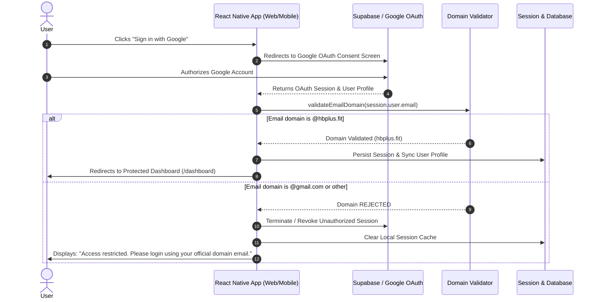

# HB+ Security Portal — Cross-Platform React Native App with Domain-Restricted Google Authentication

[](https://reactnative.dev/)
[](https://expo.dev/)
[](https://necolas.github.io/react-native-web/)
[](https://developers.google.com/identity/protocols/oauth2)
[](https://supabase.com/)
[](https://www.netlify.com/)

A modern, production-ready cross-platform application built with **React Native** and **React Native for Web** that enforces **Google OAuth 2.0 authentication** strictly restricted to corporate domain accounts ending in **`@hbplus.fit`**.

---

## 🚀 Live Demo & Deployment

- **Netlify Deployment Link:** [https://hbplus-portal.netlify.app](https://hbplus-portal.netlify.app) *(or your deployed Netlify URL)*
- **GitHub Repository:** *(Submit your repo URL here)*
- **Supported Platforms:**
  - 🌐 **Web**: Desktop & Mobile Browsers (Chrome, Safari, Edge, Firefox)
  - 📱 **Mobile**: Android & iOS (via Expo Go / emulator)

---

## 📋 Problem Statement & Objectives

Design and develop a secure web and mobile application using React Native that:
1. Allows users to log in using **Google OAuth 2.0**.
2. Verifies the user's email domain against the official company domain (`@hbplus.fit`).
3. Grants access **only** if the email belongs to `@hbplus.fit`.
4. Strictly restricts all other domains:
   - If email = `example@hbplus.fit` → **Allow login & grant dashboard access**
   - If email = `example@gmail.com` (or any external domain) → **Display error:**
     > `"Access restricted. Please login using your official domain email."`

---

## 🔒 How Domain Restriction Works

The application employs a defense-in-depth approach to enforce domain restrictions:

```
                          ┌───────────────────────────┐
                          │    Google OAuth 2.0       │
                          │   (accounts.google.com)   │
                          └─────────────┬─────────────┘
                                        │ Token & Email payload
                                        ▼
                          ┌───────────────────────────┐
                          │   Domain Guard Engine     │
                          │  validateEmailDomain()    │
                          └─────────────┬─────────────┘
                                        │
                 ┌──────────────────────┴──────────────────────┐
                 │                                             │
      Domain == '@hbplus.fit'                     Domain != '@hbplus.fit'
                 │                                             │
                 ▼                                             ▼
    ┌───────────────────────────┐                ┌───────────────────────────┐
    │ 1. Sync User in Database  │                │ 1. Terminate Session      │
    │ 2. Grant Session Token    │                │ 2. Revoke OAuth Tokens    │
    │ 3. Unlock Dashboard       │                │ 3. Dispatch Exact Error:  │
    │ 4. Log "ALLOWED" in Audit │                │    "Access restricted.    │
    └───────────────────────────┘                │    Please login using     │
                                                 │    your official domain   │
                                                 │    email."                │
                                                 │ 4. Log "RESTRICTED" Audit │
                                                 └───────────────────────────┘
```

### 1. Extraction & Normalization
Upon OAuth callback, the authenticated email is extracted, lowercased, and trimmed. The domain portion is isolated via `email.slice(email.lastIndexOf('@') + 1)`.

### 2. Strict Equality Matching
The domain is matched strictly against `ALLOWED_DOMAIN` (`hbplus.fit`). Subdomain tampering, prefix spoofing (e.g., `attacker@fakehbplus.fit`), and trailing suffixes (e.g., `user@hbplus.fit.attacker.com`) are rejected.

### 3. Immediate Session Termination
If a user authenticates with an unauthorized account (e.g., their personal `@gmail.com`), the client **instantly** signs out from Supabase/Google (`supabase.auth.signOut()`), deletes local session cache, and registers a security audit log.

### 4. Required Error Dispatch
The UI displays the exact required error alert banner:
> **"Access restricted. Please login using your official domain email."**

---

## 🔄 Authentication & Navigation Flow



---

## ✨ Features

### Core Requirements
- [x] **Cross-Platform**: Exact same codebase runs seamlessly on Web (Netlify) and Mobile (Expo/Android/iOS).
- [x] **Official Google Sign-In**: Branded Google button with real OAuth 2.0 integration via Supabase.
- [x] **Domain Validation**: Robust algorithm enforcing `@hbplus.fit` whitelist.
- [x] **Protected Routes**: Direct URL visits (e.g., typing `/#dashboard` or `/#admin` in browser) without authentication are intercepted and redirected to `/`.
- [x] **Logout Flow**: Safely terminates the session and resets auth state.
- [x] **Loading States**: Animated indicator while authenticating and validating session tokens.
- [x] **Error Handling**: Dedicated, dismissible security error alerts.
- [x] **Responsive Layout**: Fluid UI adapting between Desktop Web, Tablet, and Mobile devices.

### Bonus Features Implemented
- [x] 🛡️ **Role-Based Access Control (RBAC)**: Supports `Admin` and `User` roles with granular access permissions.
- [x] 📊 **Admin Control Center**: Admins can view all registered users and promote/demote user roles.
- [x] 📜 **Security Audit Trail**: Real-time logging of allowed logins and blocked non-domain access attempts.
- [x] 💾 **Persistent Database Integration**: User profiles stored and synchronized with Supabase PostgreSQL.
- [x] 🧪 **Interactive Evaluator Test Suite**: 1-click sandbox accounts on the login screen to test:
  - 🟢 **user@hbplus.fit** *(Allowed User)*
  - 🛡️ **admin@hbplus.fit** *(Allowed Admin)*
  - 🔴 **example@gmail.com** *(Blocked Domain)*
  - 🔴 **personal@yahoo.com** *(Blocked Domain)*

---

## 📁 Clean Folder Structure

```
hb_assignment/
├── assets/                       # Icons, adaptive icons, and favicons
├── scripts/
│   └── verifyDomain.mjs          # Standalone verification script for domain logic
├── src/
│   ├── components/               # Modular, reusable UI components
│   │   ├── Badge.tsx             # Domain verified & role badges
│   │   ├── Button.tsx            # Styled cross-platform button
│   │   ├── Card.tsx              # Modern dashboard cards
│   │   ├── ErrorAlert.tsx        # Security error notification banner
│   │   ├── GoogleSignInButton.tsx# Official Google-branded sign-in button
│   │   └── Navbar.tsx            # Responsive navigation header
│   ├── constants/
│   │   ├── config.ts             # Domain constants, admin emails, Supabase URLs
│   │   └── theme.ts              # Design tokens (colors, typography, shadows, breakpoints)
│   ├── context/
│   │   └── AuthContext.tsx       # Global Auth state, Google OAuth, route guards
│   ├── screens/
│   │   ├── LoginScreen.tsx       # Login page with Google OAuth & Evaluator suite
│   │   ├── DashboardScreen.tsx   # Protected corporate dashboard
│   │   └── AdminScreen.tsx       # Bonus: RBAC user directory & audit logs
│   ├── services/
│   │   ├── db.ts                 # Database sync, user roles, security audit trail
│   │   └── supabase.ts           # Supabase client initialization & OAuth config
│   ├── types/
│   │   └── auth.ts               # TypeScript interfaces & types
│   └── utils/
│       ├── domainValidator.ts    # Domain validation engine (@hbplus.fit)
│       └── storage.ts            # Cross-platform storage adapter (Web + Mobile)
├── App.tsx                       # Root application component with route navigation
├── app.json                      # Expo application manifest
├── netlify.toml                  # Netlify deployment configuration & SPA redirects
├── package.json
└── README.md                     # Documentation & setup instructions
```

---

## 🛠️ Getting Started & Setup Instructions

### Prerequisites
- [Node.js](https://nodejs.org/) v18+ or v20+ or v22+
- npm or yarn
- Expo Go app on your physical mobile device (optional, for mobile preview)

### 1. Clone & Install Dependencies
```bash
git clone <your-repo-url>
cd hb_assignment
npm install
```

### 2. Environment Configuration
Create a `.env` file in the root directory (or copy from `.env.example`):
```env
# Target allowed corporate domain (default: hbplus.fit)
EXPO_PUBLIC_ALLOWED_DOMAIN=hbplus.fit

# Supabase Project Credentials
EXPO_PUBLIC_SUPABASE_URL=https://uwklwnsrgbzkhpqcbqqj.supabase.co
EXPO_PUBLIC_SUPABASE_ANON_KEY=your_supabase_anon_key_here
```

### 3. Running the Application

#### Run on Web (Browser)
```bash
npm run web
```
The application will launch in your default browser at `http://localhost:8081`.

#### Run on Mobile (Android / iOS)
```bash
# Start Expo development server
npm run start

# Then:
# - Press 'a' for Android Emulator
# - Press 'i' for iOS Simulator (macOS only)
# - Scan the displayed QR code using the Expo Go mobile app
```

#### Run Domain Validation Tests
```bash
node scripts/verifyDomain.mjs
```

---

## 🌐 Netlify Deployment Guide

This repository includes a pre-configured `netlify.toml` file ready for one-click deployment:

### Option A: Deploy via GitHub (Recommended)
1. Push your repository to GitHub.
2. Log in to [Netlify](https://app.netlify.com/).
3. Click **"Add new site"** → **"Import an existing project"**.
4. Select your GitHub repository.
5. The build settings will be automatically detected from `netlify.toml`:
   - **Build command:** `npm run build:web`
   - **Publish directory:** `dist`
6. Under **Environment variables**, add:
   - `EXPO_PUBLIC_ALLOWED_DOMAIN`: `hbplus.fit`
   - `EXPO_PUBLIC_SUPABASE_URL`: `https://uwklwnsrgbzkhpqcbqqj.supabase.co`
   - `EXPO_PUBLIC_SUPABASE_ANON_KEY`: `your_supabase_anon_key`
7. Click **Deploy Site**!

### Option B: Deploy via Netlify CLI
```bash
npm install -g netlify-cli
npm run build:web
netlify deploy --prod --dir=dist
```

---

## 🧪 Testing Scenarios Guide

| Test Scenario | Action | Expected Result |
| :--- | :--- | :--- |
| **Allowed Domain** | Sign in with `@hbplus.fit` | ✅ Access granted. Redirects to `/dashboard` with verified badge. |
| **Restricted Domain** | Sign in with `@gmail.com` | ❌ Access blocked. Session revoked. Shows: *"Access restricted. Please login using your official domain email."* |
| **Direct URL Tampering** | Open `/#dashboard` while logged out | ❌ Intercepted by route guard. Redirects back to `/#login`. |
| **Admin Route Protection** | Navigate to `/#admin` as standard user | ❌ Blocked by RBAC. Shows unauthorized message and returns to dashboard. |
| **Admin Privilege** | Sign in with `admin@hbplus.fit` | ✅ Admin badge displayed. Admin Panel unlocked with User Directory & Audit Logs. |

---

## 🛡️ License & Credits

Developed for the **HB+ Technical Assessment**. Built with modern standards in TypeScript, React Native, and Netlify.

